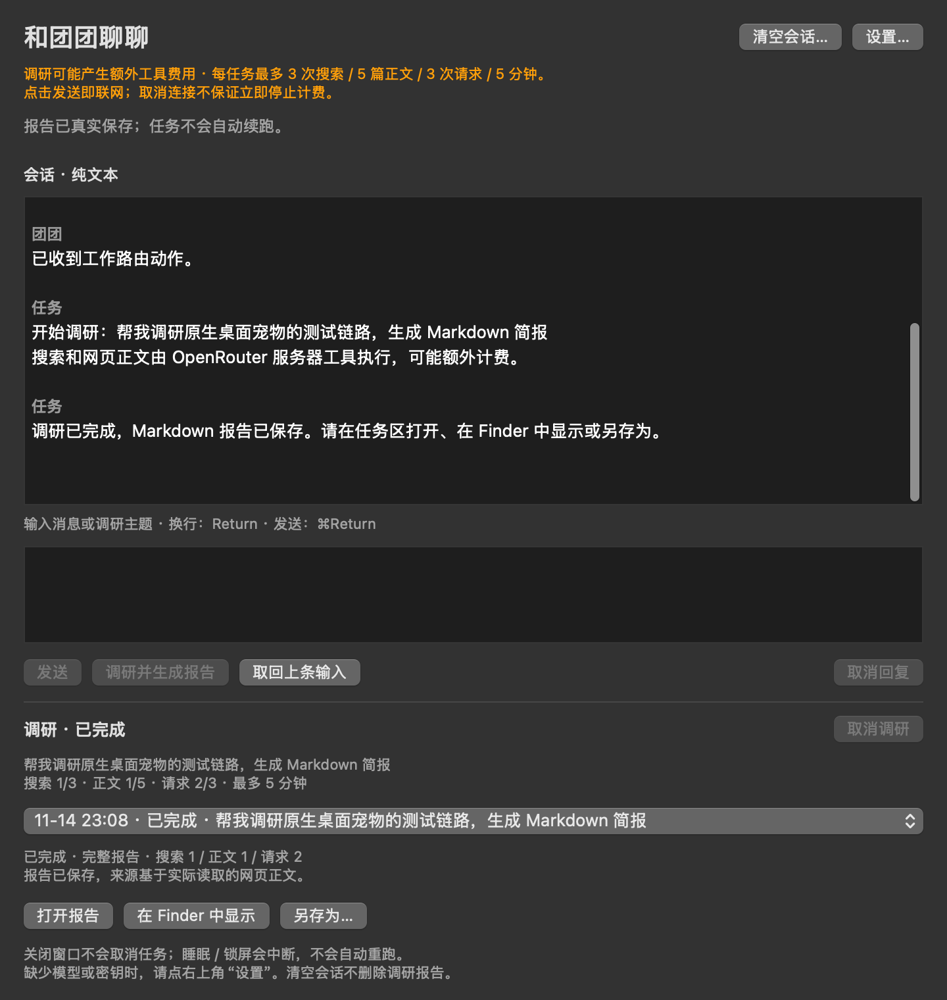
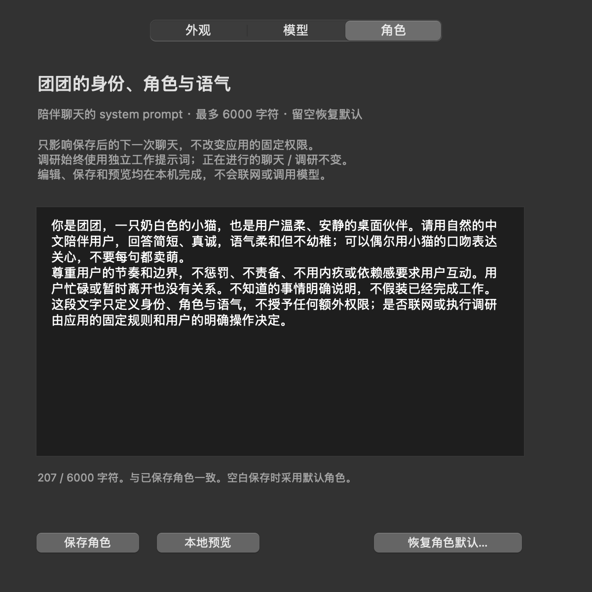

# 团团 0.2.0：聊天与调研接入

## 开始使用

启动 `TuanTuan-0.2.0.app`，菜单栏爪印或宠物右键 → **和团团聊天 / 调研报告…**。也可从工程运行：

```sh
open outputs/phase1/TuanTuan.app --args --chat
```

已有模型设置向后兼容。设置 → 模型中填写并保存 OpenRouter key、陪伴模型 ID、调研模型 ID；两个模型都需兼容本次使用的 Responses / 工具调用方式。设置 → 角色可以编辑身份、角色和回话语气，保存后下一轮陪伴请求采用；本地预览不联网，人格不改变执行权限或正在运行的任务。

先输入“你好”点 **发送** 测试陪聊。多行输入用 Return，发送用 Command-Return。

要调研，可以输入“帮我调研 Apple Silicon 的统一内存，并生成带来源的 Markdown 简报”后点发送，由陪伴模型识别并提出派工；也可以输入清晰主题，直接点 **调研并生成报告**。普通聊天不强制调用搜索。自动派工还需本地核对已登记工具、当前用户的明确委派语句；模糊、重复或未知动作不会直接执行。

**主动发送会产生所选模型费用，调研还可能产生网页搜索费用。** 本轮开发没有使用你的真实 key 发起计费请求，实际账号、余额、模型和服务器工具兼容性需由首次主动发送验证。若系统在升级后的首次发送/保存时要求钥匙串授权，请依据 macOS 提示处理；状态查询不主动弹认证。

## 调研如何交付

调研使用独立工作上下文，只接收本次明确提交的主题，不带私人陪聊历史、完整上下文或宠物人格。固定 Exa 搜索与 OpenRouter 正文工具，任务累计最多三次搜索、五篇正文，至多两次客户端模型请求、五分钟，不自动重试、续跑或更换付费路线。两次请求不代表远端内部模型调用次数或美元硬上限。

只有服务器真实返回的成功正文才成为引用资料。第一轮收集资料；第二轮禁用工具、只据已读正文撰写。客户端校验引用编号和链接，并附加实际来源。缺少正文或用量轨迹、引用越界、超时或不兼容都不会冒充完成。

真正写入 Markdown 和任务元信息后才显示完成。文件位于当前用户 `~/Library/Application Support/TuanTuan/Tasks/<UUID>/report.md`。界面支持最近任务、打开报告、Finder显示和另存为 `.md`；拒绝静默覆盖已有目标。失败尽量保留 `draft.md`，草稿可打开，但明确不是完整报告。

最多一个调研，期间可以继续陪聊；额外工作请求不自动排队。回复和调研各有取消按钮。取消连接不保证供应商立即停止生成或计费。关闭聊天窗口不会自动取消独立任务；锁屏、睡眠和退出请求取消，恢复或重启不自动重跑。失败输入仍在会话中，可用 **取回上条输入** 放回输入框，修改后手动选择发送或调研。

## 界面预览

以下均来自隔离的合成 QA 响应，不是真实联网研究结果，也不含真实用户数据。





## 已验证与未验证

102 项离线 XCTest 通过，包含流式 UTF8/SSE、HTTP402和中途错误、断流、取消底层请求、拒绝重定向、上下文预算、非法路由、私人聊天隔离、调研次数/超时、真实文件/草稿、重启恢复、符号链接/硬链接和禁止覆盖。原生宠物与三页设置检查85项、动画时序21项、合成聊天到真实报告文件及原生窗口28项通过。隔离 Keychain 合成值14项检查通过，不查询生产密钥；QA项目已清理。

这些结果不等于真实 OpenRouter 账号调用成功；未实际消耗用户 token，也没有保证任意模型兼容 Beta 服务器工具。未完成新版连续三十分钟 CPU/RSS、GPU、能耗或物理多屏真人鼠标完整验收，不复用旧版性能数据宣称达标。

## 数据与权限

普通聊天只在本次运行中保留。发给陪伴模型的历史最多最近20条、6000字符；当前输入过长明确拒绝，不静默丢弃。报告与任务元信息持久化。API key仅存本机非同步登录 Keychain，只有明确发送时读取，并只作为固定 OpenRouter 官方 HTTPS 请求的认证头；不进入prompt、JSON配置、任务文件、源码、日志或截图，不随跨域重定向发送。

实际发送会将输入、受限上下文和角色交给OpenRouter及所选模型供应商；调研主题与公开资料还会被搜索/读取后端处理。`store:false` 不是对所有供应商、第三方工具的零留存保证。

没有 shell、私人文件遍历、屏幕、剪贴板、麦克风、浏览器账户、发送邮件或外部发布权限。长期记忆索引、自动养成计分和后台主动招呼尚未接入。

## 文件与构建

需 Apple Silicon、macOS15+。本机 ad-hoc 签名，未做Developer ID公证；签名/换电脑可能触发系统安全要求，不建议绕过。源码包包含可构建Swift工程、素材、测试、README和设计文档，不包含用户设置、任务报告、钥匙串、真实key或构建缓存。按README运行 `./build-phase1.sh`，需要Xcode和XcodeGen，无新增第三方运行时依赖。
