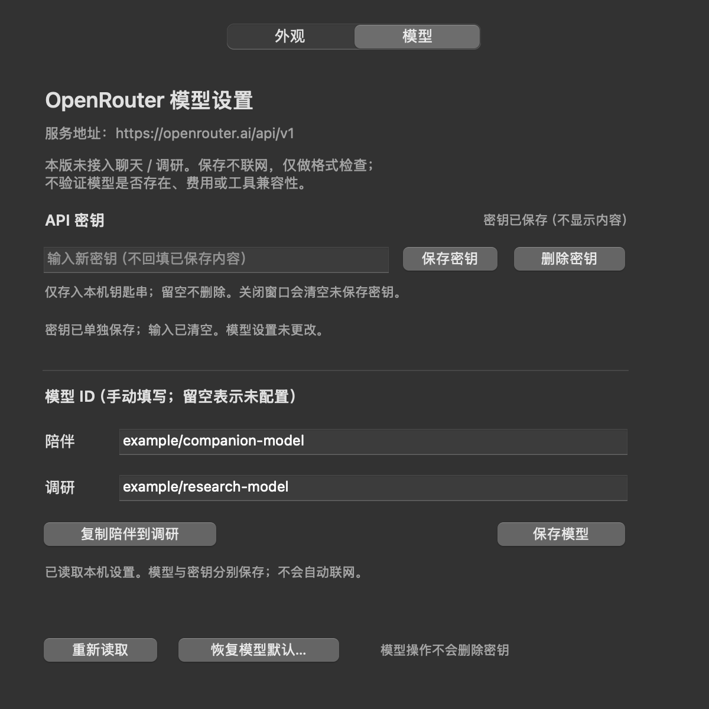

# 团团 0.1.2：自定义模型设置

## 如何设置

打开 `TuanTuan-0.1.2.app`（或解压应用包后双击），在菜单栏爪印或宠物右键菜单选择 **设置：外观与模型… → 模型**。

1. 在安全输入框填写自己的 OpenRouter API key，点击“保存密钥”。成功后输入清空，只显示已保存状态。不要把真实 key 发到对话或放进源码。
2. 填写“陪伴”和“调研”各自的完整模型 ID，格式为 `provider/model-id`；可以使用不同模型，或点击“复制陪伴到调研”共用一个。
3. 点击“保存模型”。两个 ID 保存到本机，重启后保留。密钥与模型分别保存，一个失败不会冒充另一个成功。
4. 外观页仍可调整 100–220 pt 尺寸，结束拖动时保存，重启恢复；四分区触摸和原有短动画保留。

界面预览使用隔离 QA 配置与示例模型，不是真实用户数据，也不代表示例模型可用：

## 已支持

模型 ID 手填、格式检查、独立保存、复制、重读、恢复默认；尺寸持久化；未保存模型输入保留；配置损坏保护及明确恢复。清空密钥输入不等于删除，恢复模型默认不删除密钥，关闭设置会清空未保存密钥。

普通配置是当前用户 `~/Library/Application Support/TuanTuan/settings.json`，只包含尺寸和两个模型 ID。密钥使用 macOS 本机非同步登录 Keychain，不写普通 JSON、日志、截图或源码，不回填明文。钥匙串权限拒绝或锁定时明确提示，不使用明文回退。应用启动不读取密钥正文。

## 重要边界

**这是模型配置能力，不是聊天或调研执行能力。** 保存不联网、不消耗模型 token；仅校验 ID 格式，不验证模型存在、费用、结构化动作或工具兼容性。没有自动获取模型列表、默认模型推荐或静默换模型。OpenRouter 地址固定，暂不支持自定义代理域名。

陪伴聊天、人格 system prompt 编辑、长期记忆和调研 Agent 仍按已确认设计留待后续实现。当前没有调用真实 OpenRouter、没有使用用户真实 key 进行验证。

## 验证

30 项纯逻辑 XCTest、67 项原生设置与窗口检查、21 项动画时序检查全部通过。系统 Keychain 用随机 QA 项与合成值单独验证，10 项通过，结束后清理，不接触生产密钥。应用签名、版本及应用/源码压缩包完整性也已核验。

本轮不将旧 0.1.1 性能数字当作 0.1.2 最终验收。未完成新版三十分钟 CPU/RSS、GPU、能耗或跨应用真人鼠标端到端测试。

## 运行与源码

需 Apple Silicon、macOS 15+。原生 Swift/AppKit，无新增第三方运行时依赖。应用是本机 ad-hoc 签名，未做 Developer ID 公证；重新签名/换电脑可能需要新的系统安全授权，不建议绕过系统检查。钥匙串数据不随应用包/源码包复制。

`TuanTuan-Source-0.1.2.zip` 包含源码、素材、XcodeGen 配置、可重复构建脚本、测试和设计文档，不包含用户配置、用户钥匙串、构建缓存或 API key。按 README 执行 `./build-phase1.sh`；最新构建仍写入工程的 `outputs/phase1`，不影响本次已交付的独立版本包。
